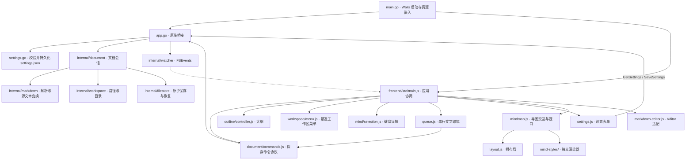
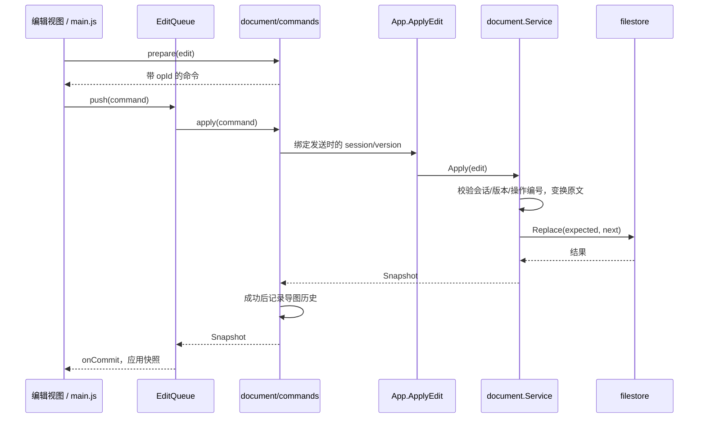

# OpenMind 代码地图

> 2026-10-31，版本 0.9.45，基于当前工作区。本文描述实际结构及尚存耦合，不代表所有重构都已完成。

## 为什么改动容易牵连

| 问题 | 具体证据 | 本轮处理 |
| --- | --- | --- |
| 前端入口承担过多责任 | main.js 原有 1188 行，包含保存、导图操作、大纲、工作区菜单、窗口、关闭流程 | 分离命令、大纲、导航和工作区菜单；入口降至约 970 行，仍需继续收敛 |
| 通用桥接隐藏业务副作用 | 原 call() 调用 ApplyEdit 时暗中记录导图历史 | 桥接只转发；命令模块显式处理历史与版本 |
| 保存协议散落 | 文字队列和新增、移动、删除、撤销分别拼 session/version/opId | commands 统一命令编号和发送时版本绑定 |
| 测试依赖函数摆放位置 | 三份测试用字符串切片从 main.js 提取函数并在 VM 执行 | 改为直接调用导出的模块接口 |
| 状态组合依然复杂 | navigating、checking、blocked、closing、节点操作状态分散在入口 | 本轮保留既有时序；未将全部布尔状态仓促替换成新状态机 |
| 编辑器兼容逻辑集中 | markdown-editor.js 同时适配 Vditor、输入法、光标及多种输入修正 | 保留现状，避免与此次职责拆分同时改动编辑行为 |
| 文档与实现漂移 | README 的严格三级导图规则落后于 mind.go 的宽松层级实现 | 本图按源码描述；历史说明不能代替行为测试 |

文件数量不是架构清晰度的指标。每个模块应拥有明确职责，依赖通过参数传入，测试通过与应用相同的接口验证行为。

## 总体依赖

箭头代表调用或依赖，虚线代表事件通知。

## 前端目录与接口

| 路径 | 职责与接口 |
| --- | --- |
| [main.js](frontend/src/main.js) | 应用装配、文档切换、快照应用、节点编辑生命周期、窗口和退出协调 |
| [document/commands.js](frontend/src/document/commands.js) | `createDocumentCommands`：`prepare(edit)` 分配操作编号，`apply(edit)` 绑定当前会话和版本，成功后记录历史；恢复历史不新增历史项 |
| [queue.js](frontend/src/queue.js) | `EditQueue`：串行发送、容量限制、失败暂停与 drain；不拥有 DOM |
| [mind/tree-navigation.js](frontend/src/mind/tree-navigation.js) | `nodePath` / `nodeAtPath`：树路径与节点查找；不依赖窗口或磁盘 |
| [mind/selection.js](frontend/src/mind/selection.js) | `createMindSelection` 返回方向键导航函数；等待编辑与保存，恢复节点选择和折叠 |
| [outline/controller.js](frontend/src/outline/controller.js) | `createOutline`：render、syncCollapse、focus 与显示选项；负责 md/mind 大纲的 DOM 和定位 |
| [workspace/menu.js](frontend/src/workspace/menu.js) | `createWorkspaceMenu`：close、refresh、refreshVisible、toggle；内部拥有最近条目和右键目标，通过回调请求切换工作区 |
| [mindmap.js](frontend/src/mindmap.js) | 导图选中、编辑框、拖动、聚焦、缩放和渲染器协调 |
| [layout.js](frontend/src/layout.js)、[node-drop.js](frontend/src/node-drop.js) | 树布局与拖放目标计算 |
| [mind-styles/](frontend/src/mind-styles/) | processon / mindnode 各自测量、绘图和 CSS；不互相复用渲染实现 |
| [markdown-editor.js](frontend/src/markdown-editor.js) | Vditor 生命周期、正文输入、光标、图片导入适配 |
| [settings.js](frontend/src/settings.js) | 设置界面与保存 |
| [document-mode.js](frontend/src/document-mode.js) | 文件模式判断、标题、图片和链接地址 |
| [features/](frontend/src/features/) | 搜索、文件树操作、表格、图片导入、导图历史及通用交互 |
| [vendor/vditor/](frontend/src/vendor/vditor/) | 内置第三方编辑器及许可证 |

新增功能不应继续默认堆入 main.js。优先查找所属模块；跨模块流程由入口协调，具体 DOM 行为留在所属模块。

## Go 后端导航

| 路径 | 职责 |
| --- | --- |
| [main.go](main.go)、[app.go](app.go) | Wails 启动、绑定、生命周期、工作区切换与事件通知 |
| [settings.go](settings.go)、[workspace_history.go](workspace_history.go) | 设置与最近工作区持久化 |
| [external_open.go](external_open.go)、[window_darwin.go](window_darwin.go) | 外部打开文件与窗口行为 |
| [document_assets.go](document_assets.go) | `/document-assets/` 图片入口 |
| [internal/document/service.go](internal/document/service.go) | Snapshot/Edit、当前文档会话、编辑校验、保存协调、外部变更检查和草稿 |
| [internal/document/](internal/document/) | 文件移动/重命名/删除、图片导入/恢复/清理、节点复制 |
| [internal/markdown/document.go](internal/markdown/document.go)、[mind.go](internal/markdown/mind.go) | 原文与树模型、模式分流、导图解析 |
| [internal/markdown/](internal/markdown/) | insert/delete/move/copy/color/fold 源文本变换、资源引用分析 |
| [internal/workspace/](internal/workspace/) | 工作区身份、路径边界、目录树和排序 |
| [internal/filestore/](internal/filestore/) | 文件校验、并发修改检测、恢复副本和原子替换 |
| [internal/watcher/](internal/watcher/)、[internal/bookmark/](internal/bookmark/) | macOS 文件变化通知与目录引用 |
| [internal/window/](internal/window/)、[internal/appicon/](internal/appicon/) | macOS 窗口和图标 |

本轮未调整 Go 包结构；其解析、文档协调和存储分层已存在，当前主要耦合集中在前端。

## 保存与同步协议

- 文字编辑通过队列；新增、删除、移动和撤销先等待编辑完成，再通过同一 commands 接口提交。未改变这两种调度方式。
- Snapshot 包含 session、version、path、source、root、hash，以及节点 ID 映射等操作结果。
- Markdown 原文是持久化数据；节点树是投影。节点 ID 不能视为永久 ID，重解析后通过路径或返回映射恢复选择。
- 外部同步：FSEvents → App 事件 → main.js 检查当前状态 → CheckDocument → 新快照。
- 图片：正文通过文档服务导入至同级 `.assets/文档名/`，使用相对引用；读取经带会话的资源入口，保存协调资源恢复与清理。

## 行为约束与验证

- 保留 `.mind.md` 与普通 Markdown 两种模式，保持已有文件、设置及 Go 桥接格式。
- Mind 解析支持六级标题和嵌套 `-`，允许省略层级；具体以 mind.go 和对应测试为准。
- 保留两套独立导图风格，不修改原有注释与第三方编辑器。
- 普通测试：`go test ./...`、`node --test frontend/test/*.test.js`。
- 真实交互：scripts 下的 macOS WebKit 脚本；既有失败必须与重构前基线对照，不能当作通过项。
- 打包：[scripts/build-macos.sh](scripts/build-macos.sh)；版本同步修改 wails.json 与 frontend/index.html，并执行版本测试。

## 尚未完成的架构收敛

main.js 仍拥有共享状态、节点操作互斥、快照应用、窗口与退出流程；outline 与 selection 仍读取部分共享状态。本轮提供可直接测试的接口，尚未实现完全独立的文档会话状态机。

后续优先把“结束当前编辑 → 等待图片和保存 → 切换/关闭”的流程封装成文档会话模块，并针对输入法、保存失败、外部更新和关闭竞态建立行为测试，再逐步迁移调用方。不要只搬文件后把所有状态透传，也不要在重构过程中顺带改变交互。

产品原则：[examples/灵感.mind.md](examples/灵感.mind.md)；架构决策：[ARD.md](ARD.md)。

## 0.9.44 重构验证记录

- 通过：98 个前端单元测试、版本一致性测试、Go 测试及 race 检查。
- 通过：WebKit 搜索 64 项、真实文档服务的导图历史 35 项、最近工作区菜单回归、两种风格多行编辑 38 项。
- 已有失败：`test-node-modes.mjs` 的折叠/菜单断言、`test-mind-rules.mjs` 的 MindNode 连线/粗细断言。均在隔离副本中换回重构前 main.js 后复现相同失败，未声称这些脚本通过。
- macOS arm64 重新打包为 0.9.44，Info.plist 两个版本字段一致，包签名校验通过。
- 打包基于当前工作区，包含用户原先未提交的编辑器改动；Git 提交仅包含本轮重构、版本与文档修改。
