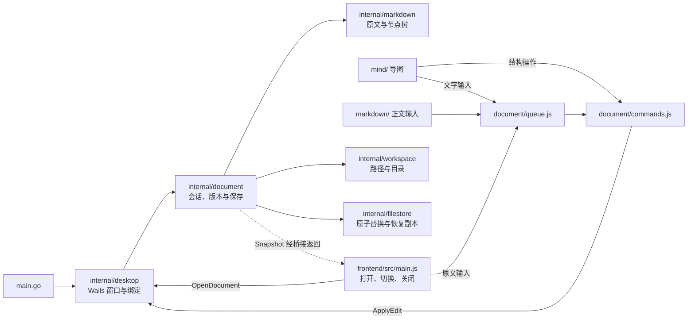

# OpenMind 代码地图

从一个文件追到另一个文件，沿下面两条线即可。Go 持有当前文档会话，磁盘上的 Markdown 是正文来源。

| 要改什么 | 先看这里 | 职责 |
| --- | --- | --- |
| 打开文件、设置持久化、桌面窗口 | [internal/desktop/](internal/desktop/) | Wails 绑定与应用生命周期。系统调用在 window、watcher、bookmark、appicon 包 |
| 文件树、最近工作区 | [workspace/](frontend/src/workspace/) | 菜单、拖放、行操作。磁盘变更由 [document/](internal/document/) 执行 |
| 导图节点、连线与布局 | [mind/](frontend/src/mind/) | 导航、交互、布局、历史。两种外观各自在 styles 下 |
| 哪些 Markdown 行形成节点 | [mind.go](internal/markdown/mind.go) | 标题、列表与原文位置。同包负责节点增删、移动和标记 |
| 正文、图片与表格输入 | [markdown/](frontend/src/markdown/) | Vditor 适配及正文操作。第三方库在 src/vendor |
| 大纲、文档搜索、设置表单 | [outline/](frontend/src/outline/)、[document/](frontend/src/document/)、[ui/](frontend/src/ui/) | 各自管理大纲交互、文档命令与搜索、界面控件与设置项 |
| 保存冲突、恢复与外部修改 | [service.go](internal/document/service.go) | 校验 session/version，返回新快照。前端在 main.js 协调草稿与视图 |

文字输入串行入队。移动、删除、撤销等结构操作等待正在进行的编辑结束，再经同一个命令入口提交。追查“切换时丢字”先看 main.js 的 readyToNavigate 和 closeApp。

**验证与交付。** [frontend/test/](frontend/test/) 放 Node 单元测试，Go 测试与实现同目录。[tests/macos/](tests/macos/) 放原生探针和运行器，cases/ 放页面用例及夹具。[scripts/](scripts/) 只放构建与浏览器预览命令，具体命令见 [README](README.md)。

**非代码资料。** [examples/](examples/) 放可打开的示例，[skills/](skills/) 放可复用的编辑指引。[ARD.md](ARD.md) 记录决策，[docs/](docs/) 存放说明配图、复盘与历史方案。build/ 的构建输入是图标和 darwin 模板，生成的应用位于 build/bin/。
