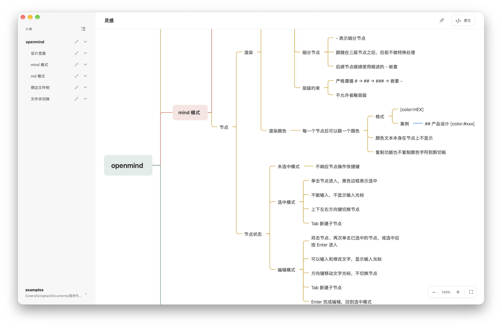
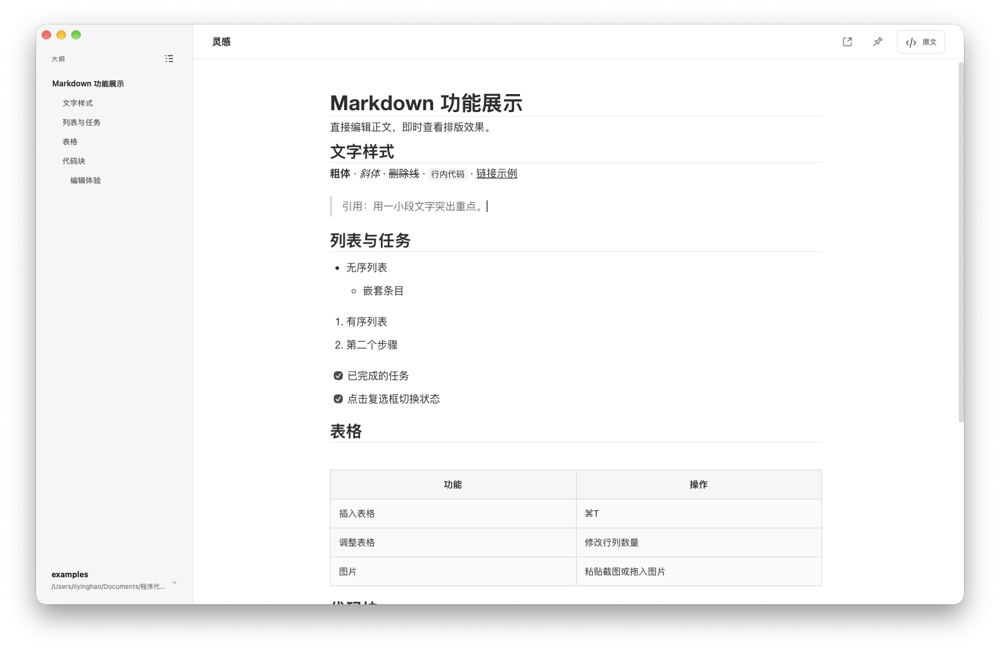

<p align="center">
  
</p>

<h1 align="center">OpenMind</h1>

<p align="center"><strong>Markdown 是你的思维原稿。</strong></p>
<p align="center">用导图梳理想法，用文字展开思考。内容始终留在你的本地文件里。</p>
<p align="center"><sub>A Markdown-native mind mapping and writing app for macOS.</sub></p>

<p align="center">
  <a href="#experience">看看它</a> ·
  <a href="#start">开始使用</a> ·
  <a href="#format">导图语法</a> ·
  <a href="#development">本地开发</a> ·
  <a href="#contributing">参与贡献</a>
</p>

<p align="center"><sub>macOS 13+ · 本地文件 · 自动保存 · 键盘优先 · <a href="#license">源码可用 / 非商业用途</a></sub></p>



<p align="center"><sub>导图中的结构，就是 Markdown 中的标题与列表。截图来自项目自带的只读预览。</sub></p>

## 介绍

OpenMind 是一款面向 macOS 的本地思维导图与 Markdown 编辑器。用 `.mind.md` 整理层次，用 `.md` 写下细节；两种方式，共用一个文件夹。

导图直接读写 Markdown，节点编辑会写回原文，原文修改也会更新导图。文件可以用其他文本编辑器打开，也可以纳入你自己的 Git 仓库。无需注册账户，也无需专有文档格式。

界面尽量留白，常用操作交给键盘，额外控件按需开启。让工具安静一点，让思考连贯一点。

## 两种方式渲染md文件


|      | Mind 模式                      | Markdown 模式                  |
| ---- | ------------------------------ | ------------------------------ |
| 文件 | `灵感.mind.md`                 | `笔记.md` / `笔记.markdown`    |
| 适合 | 拆解问题、梳理知识、组织结构   | 记录细节、写作、阅读           |
| 编辑 | 在节点中直接输入，拖动整条分支 | 类似 Typora 的即时渲染正文编辑 |
| 导航 | 折叠、分支聚焦、大纲定位       | 六级标题大纲                   |
| 原文 | 与导图并排编辑                 | 切换到完整 Markdown 编辑       |

**在结构中思考。** 多个主节点各自展开，分支可以拖动、折叠、聚焦和设色。提供 processon 与 MindNode 两种渲染风格，在 `F12` 设置中切换。

**在文字中展开。** 标题、引用、任务列表、表格、代码块、链接和图片直接呈现在正文中。支持粘贴截图、拖入图片，以及调整表格行列。



<p align="center"><sub>Markdown 模式 · 项目自带的只读预览</sub></p>

**在熟悉的文件夹里工作。** 浏览目录，新建、重命名、拖动文件或文件夹，将删除的内容移入 macOS 废纸篓。启动时恢复上次工作区，快捷列表保留通过「添加文件夹」加入的最多 4 个工作区；双击打开 Markdown 文件不会自动加入。

**保持思路连贯。** 编辑自动保存，外部文件变化自动同步。`⌘F` 搜索当前文档，在正文、原文和导图中定位；导图会展开匹配节点的祖先分支。

<a id="start"></a>

## 开始使用

当前提供 macOS 源码构建方式，步骤见[本地开发](#development)。构建脚本默认面向 Apple Silicon，也提供 Intel 目标；Intel 尚未完成实机验证。本地构建产物尚未正式签名和公证。

1. 打开 OpenMind，选择一个本地文件夹作为工作区。
2. 新建文档，选择 Markdown 或思维导图；已有文档按文件后缀自动选择模式。
3. 开始输入，修改会自动写入文件。需要直接编辑 Markdown 时，点击右上角「原文」。

可以选择项目的 `examples/` 文件夹体验；其中的文档会被直接编辑，建议先复制一份。

<a id="format"></a>

## 一份 Markdown，就是一张导图

将下面的内容保存为 `一个好想法.mind.md`，在工作区中打开：

```markdown
# 一个好想法

## 让它清晰

### 写下问题
- 我想解决什么？
- 谁会需要它？
  - 从一个具体的人开始

## 让它发生

### 下一步
- 做一个小原型
- 收集第一次反馈
```

导图遵循 **`# → ## → ### → 嵌套的 - 列表`**，不跳过层级。一个文件可以包含多个 `#` 主节点；三级标题下的 `-` 列表继续展开为更深的节点。

普通段落、代码块、前置元数据、四至六级标题、有序列表及 `+` / `*` 列表不会生成导图节点，但仍保留在原文中。这些约束只作用于 Mind 模式，普通 Markdown 模式支持常规正文语法。

<details>
<summary>给分支一点颜色</summary>

在节点菜单中选择颜色，或在节点末尾写入颜色标记：

```markdown
## 让它清晰 [color:#5EAA80]
```

颜色标记不显示在导图标签中，后代分支继承颜色，直到某个子节点设置自己的颜色。支持 `#RGB` 和 `#RRGGBB`；标记保存在 Markdown 中，复制分支时会移除实际节点的颜色后缀。

</details>

## 手不离键盘


| 场景               | 快捷键              | 操作                               |
| ------------------ | ------------------- | ---------------------------------- |
| 通用               | `⌘F`               | 搜索当前文档                       |
| 通用               | `⇧F6`              | 重命名当前文件                     |
| 搜索中             | `⌘G` / `⇧⌘G`     | 下一个 / 上一个匹配                |
| 通用               | `⌥⌘L`             | 切换文件树与大纲                   |
| 通用               | `F12`               | 打开或关闭设置                     |
| 导图选中节点       | `↑` `↓` `←` `→` | 在节点间移动                       |
| 导图选中节点       | `Enter`             | 开始编辑                           |
| 导图编辑节点       | `Enter` / `Esc`     | 结束编辑，回到选中状态             |
| 导图选中或编辑节点 | `Tab`               | 新建子节点                         |
| 导图选中或编辑节点 | `⌘C`               | 复制当前节点全部文本，不包含子节点 |
| 导图选中节点       | `⌘/`               | 折叠或展开分支                     |
| 导图选中节点       | `⌘Backspace`       | 删除节点                           |
| 导图画布           | `⌘Z` / `⇧⌘Z`     | 撤销 / 重做节点操作                |
| Markdown 正文      | `⌘1` … `⌘5`      | 设置对应级别标题，再按一次恢复段落 |
| Markdown 正文      | `⌘[` / `⌘]`       | 有序 / 无序列表                    |
| Markdown 正文      | `⌘K` / `⌘T`       | 代码块 / 插入表格                  |

节点右键「复制树」复制当前节点及所有子节点的 Markdown，可在 `F12` →「mind模式」→「启用复制树」中关闭，默认开启。

导图中单击选中节点，再次单击或双击进入编辑。编辑时方向键移动文字光标；`Esc` 结束编辑，但不撤销已自动保存的文字。

导图画布支持撤销和重做移动、新增、删除、设色及节点编辑，结果同步保存到原文件。输入框中沿用文字撤销；结束节点编辑后，一次撤销恢复本次编辑前的文字。历史仅在当前文档打开期间保留，重新打开、切换文档或接收外部更新后清空。

## 文件属于你

文档直接保存在工作区，编辑器运行资源随应用打包，本地文档编辑不依赖 CDN。文档引用的网络图片仍需要网络连接。

Markdown 模式导入的图片放在文档同级的 `.assets/文档名/` 中，通过相对路径引用。例如：

```text
我的知识库/
├── 灵感.mind.md
├── 笔记.md
└── .assets/
    └── 笔记/
        └── <图片 ID>.png
```

在应用内重命名或移动文档时，其专属图片目录会一起调整。通过其他工具搬运、备份或提交文档时，也请带上对应的 `.assets/` 目录。

保存使用串行写入、内容校验和原子替换，并保留恢复副本。检测到冲突时会暂停写入；点击「保留草稿并重新读取」，可保留本地草稿后读取磁盘版本。

<details>
<summary>恢复目录与当前边界</summary>

应用配置和恢复资料位于 `~/Library/Application Support/OpenMind/`，恢复文件保存在其中的 `recovery/` 目录。当前需要手动检查恢复目录，恢复资料不会自动清理，也不构成完整的版本历史。

- 文档须为有效 UTF-8，单文件不超过 **2 MiB**；单张导入图片不超过 **20 MiB**，图片导入仅支持 Markdown 模式。
- 即时渲染正文编辑可能规范化部分 Markdown 写法；仅打开文档或切换视图不会改写文件。
- 当前为单窗口、单工作区、单文档编辑；尚无跨文档搜索、公式或 Mermaid 渲染。
- 分支折叠、聚焦及侧栏展开状态不跨重启保存；功能设置会持久化。
- 工作区不跟随符号链接，拒绝编辑硬链接文件。无法保证任意云盘或外部编辑器并发写入时的一致性。
- 强制结束进程可能丢失尚未写完的输入；恢复副本不能替代独立备份。

</details>

<a id="development"></a>

## 本地开发

**环境：** macOS 13+、Xcode Command Line Tools、Go 1.25.0+、Wails CLI **v2.15.0**。前端测试和只读预览需要 Node.js；已有开发记录使用 Node.js 22。当前仅维护 macOS 版本。

前端使用原生 JavaScript / CSS，Vditor 已随源码内置，无需 `npm install` 或单独的前端打包步骤。

### 构建应用

如未安装对应版本的 Wails CLI，请自行执行：

```sh
go install github.com/wailsapp/wails/v2/cmd/wails@v2.15.0
```

在项目根目录运行：

```sh
sh scripts/build-macos.sh
open build/bin/OpenMind.app
```

默认构建 `arm64`；Intel 目标使用 `sh scripts/build-macos.sh amd64`。重新构建后，退出旧应用再打开新包。

### 只看界面

```sh
node scripts/preview.mjs
```

打开 [localhost:4173](http://127.0.0.1:4173)。预览使用内置演示数据，不读写工作区，不能替代原生应用的编辑与保存验证。本文截图取自此模式。

### 验证改动

```sh
go test -race ./...
node --test frontend/test/*.test.js
```

涉及搜索、节点交互或导图语法时，可运行对应的 macOS WebKit 回归脚本：

```sh
node scripts/test-document-search.mjs
node scripts/test-node-modes.mjs
node scripts/test-mind-rules.mjs
```

功能修改后重新构建应用，在原生窗口中确认行为，并检查包签名完整性：

```sh
sh scripts/build-macos.sh
codesign --verify --deep --strict build/bin/OpenMind.app
```

<details>
<summary>代码地图</summary>


| 路径                                                    | 职责                                           |
| ------------------------------------------------------- | ---------------------------------------------- |
| `main.go` / `app.go`                                    | Wails 启动、Go / JavaScript 桥接与应用生命周期 |
| `internal/markdown/`                                    | Markdown 解析、导图投影与源文本修改            |
| `internal/document/`                                    | 文档会话、保存协调、文件和图片操作             |
| `internal/filestore/`                                   | 文件校验、原子替换与恢复副本                   |
| `internal/workspace/` / `internal/watcher/`             | 工作区边界、目录树与 macOS 文件监听            |
| `frontend/src/mindmap.js` / `frontend/src/mind-styles/` | 导图交互与两套独立渲染器                       |
| `frontend/src/markdown-editor.js`                       | Markdown 即时渲染编辑器                        |
| `frontend/src/queue.js`                                 | 前端串行保存队列                               |
| `scripts/` / `frontend/test/`                           | 构建、预览及回归验证                           |

产品思路见 [灵感.mind.md](examples/灵感.mind.md)，架构决策及其演进见 [ARD.md](ARD.md)。[原始技术方案](TECHNICAL_DESIGN.md) 供了解背景，当前行为以代码及后续决策为准。

</details>

<a id="contributing"></a>

## 一起把它打磨好

欢迎带着具体的使用场景、问题复现和改进建议参与。提交问题时，请附上 macOS 版本、芯片架构、复现步骤，以及去除私人内容后的最小示例。

OpenMind 的取舍是：**简约、键盘优先、Markdown 原文可用。** 提议新功能时，请说明它解决了什么问题；较大的交互或架构调整，先讨论设计，再提交实现。涉及后续维护的重要决策记录在 [ARD.md](ARD.md) 中。

<a id="license"></a>

## 致谢与许可

OpenMind 使用 Wails 构建桌面应用，使用 Goldmark 解析 Markdown，使用 Vditor 提供即时渲染编辑。
