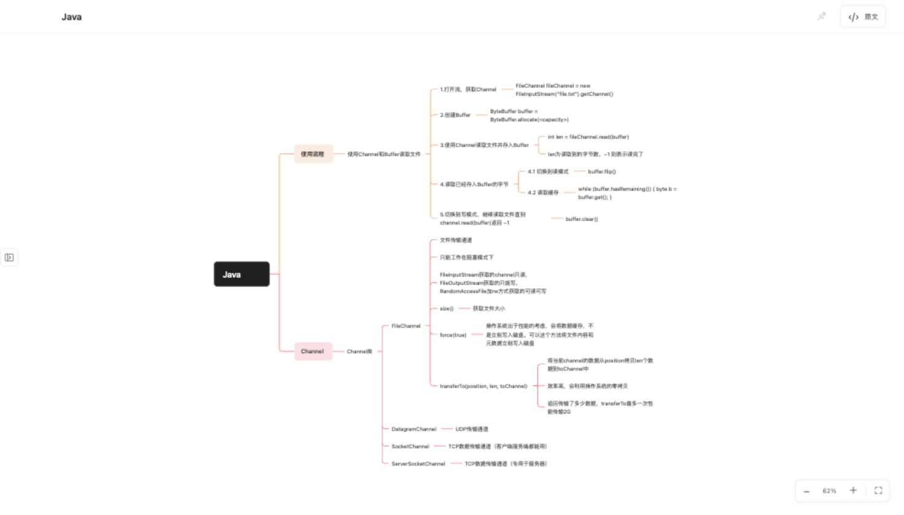
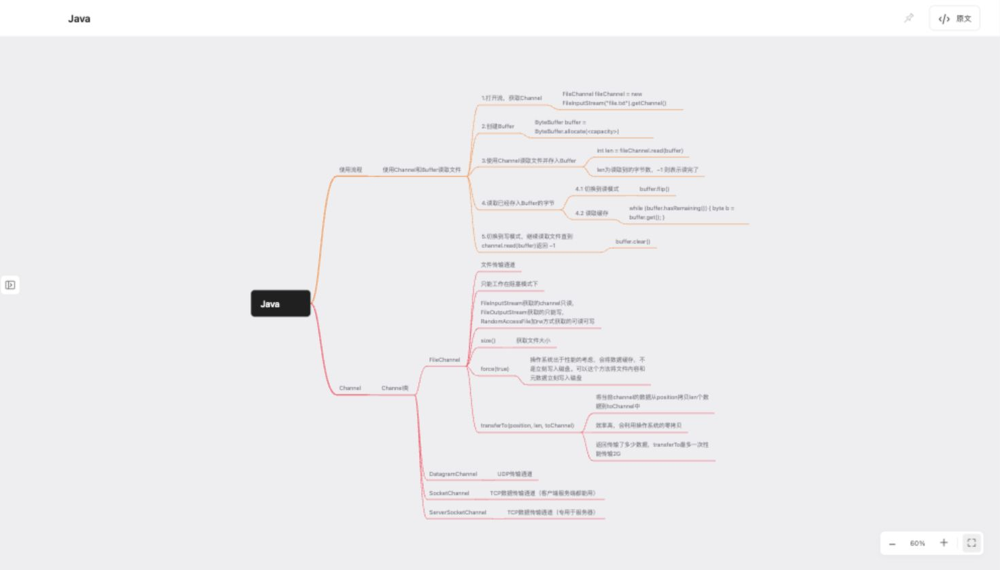

# mind 风格隔离验证

日期：2026-10-12。目标：保持两种风格原有外观及交互，将全部导图绘制实现移入各自目录。

processon：`frontend/src/mind-styles/processon/renderer.js`、`style.css`。
MindNode：`frontend/src/mind-styles/mindnode/renderer.js`、`style.css`。

两套渲染器没有相互导入、共同基类或共同绘制函数。测量缓存、节点、SVG 连线、可视区域裁剪、折叠数量、编辑框、拖动预览及配色各自实现；公共层保留文档、布局与交互。切换时清理旧 DOM，保留折叠、聚焦、选择、缩放和锚点位置，返回设置后恢复替换节点的键盘焦点。

## 验证结果

| 验证 | 结果 |
| --- | --- |
| `node --test --test-reporter=spec frontend/test/*.test.js` | 74 项通过 |
| `go test -race ./...` | 全部通过 |
| `node scripts/test-mind-rules.mjs` | 420 项原生 WebKit 检查通过，使用隔离的真实 Go 文档服务 |
| `node scripts/test-node-modes.mjs` | processon 256 项通过 |
| `OPENMIND_MIND_STYLE=mindnode node scripts/test-node-modes.mjs` | MindNode 256 项通过 |
| `sh scripts/test-node-caret.sh` | processon 144 项通过 |
| `OPENMIND_MIND_STYLE=mindnode sh scripts/test-node-caret.sh` | MindNode 144 项通过 |
| `node scripts/test-document-search.mjs` | processon 40 项通过 |
| `OPENMIND_MIND_STYLE=mindnode node scripts/test-document-search.mjs` | MindNode 40 项通过 |

原生检查合计 1300 项，涵盖折叠、聚焦、颜色及继承、点击选择与编辑、键盘导航、插入、移动、复制、删除、输入法、自动保存、搜索、重开文档、普通 Markdown 和风格切换。新增检查会临时禁用非当前风格的 CSS，比较画布、节点、连线、折叠标记、编辑框及拖动预览，确认各自样式完整。

最初一次 processon 原生点击检查在并行浏览器操作期间未选中；停止浏览器操作、单独重跑后 256 项全部通过。后续原生窗口测试均顺序运行。

## 外观对比

使用同一份只读 Java 导图、1470×838 视口、收起侧栏并适应窗口。没有修改用户文档。

- processon 截图差异仅位于适应窗口按钮的悬停区域，导图像素一致。
- MindNode 截图仅 80 个文字抗锯齿像素不同，最大颜色通道差为 2；节点、曲线和布局保持一致。

原图、差异图和 `visual-comparison.json` 位于本目录。

## macOS 包

`sh scripts/build-macos.sh` 成功，产物为 macOS arm64。`codesign --verify --deep --strict` 通过；ZIP 完整性通过，压缩包内可执行文件与新构建文件字节一致，二进制已嵌入两个独立渲染器、CSS 路径及焦点恢复修改。

产物：`build/bin/OpenMind.app`、`build/bin/OpenMind-macOS-arm64.zip`。签名沿用项目自签方式。ZIP 大小 6,582,253 字节；SHA-256：`d286cdb2677f4adde0f2b0cc989613c99a43722ac3fedadc9d482b837f9802c5`。
